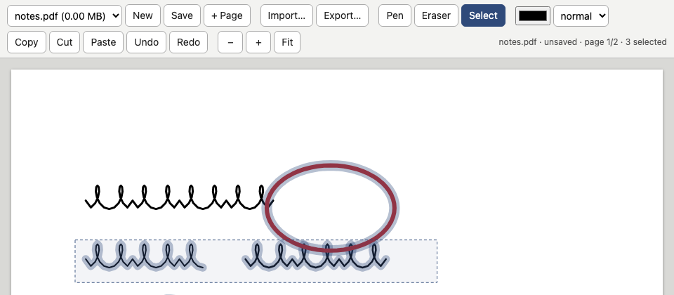

# pdfink

[](https://github.com/dannyob/pdfink/actions/workflows/ci.yml)
[](LICENSE)
[](https://pdfink.libertyh.dev/)

PDFink lets you write on a PDF with a stylus in the browser, and saves the ink back into the PDF as standard `/Ink` annotations that other PDF apps can show and edit. It's a good way to quickly make annotations to an uploaded PDF, and then re-export to a local PDF, or annotate a set of PDFs on a remote server. I use it scribble handwritten notes to myself.

**Try it:** <https://pdfink.libertyh.dev/> runs the browser-only build. Open a PDF from your device, write on it, and save it back. Nothing is uploaded or shared beyond your browser. You can use a stylus or a mouse (or your finger).



PDFink can run as a small server that offers a folder of PDFs stored on the server,
and a browser-only mode that needs no server at all. This is the server:

```console
$ node server/index.ts --mode server --port 5198 --notebooks /path/to/notebooks --dist dist
pdfink: http://127.0.0.1:5198/  notebooks=/path/to/notebooks  app=/path/to/pdfink/dist

$ curl -s http://127.0.0.1:5198/api/status
{"mode":"server","notebooksDir":"pdfink-demo-notebooks"}

$ curl -s http://127.0.0.1:5198/api/notebooks
[]
```

(That folder was empty. `notebooksDir` is just the folder's name.) 

This is browser-only mode, where the app opens and saves files on your own device:

```console
$ node server/index.ts --mode browser --port 5199 --dist dist
pdfink: http://127.0.0.1:5199/  browser mode (no notebook API)  app=/path/to/pdfink/dist

$ curl -s http://127.0.0.1:5199/api/status
{"mode":"browser"}
```

The app asks `/api/status` on load and picks its storage to match.

## Install

Node 22.18 or later. The server is TypeScript run directly by Node's built-in type stripping, with no runtime dependencies (I developed on Node 26). The app itself uses pdf.js and pdf-lib. Any modern, 2026-onwards browser should work.

```sh
npm install
npm run build
```

## Quick start

Server mode is the default:

```sh
npm start -- --notebooks /path/to/folder
```

Open http://127.0.0.1:5173/. The folder is created if it is missing. The toolbar has Open notebook... (a menu of the PDFs in the folder), New, Save, + Page, Import... (copy a PDF from the device into the folder) and Export... (download the current notebook).

Browser-only mode:

```sh
npm start -- --mode browser
```

You can also serve the static HTML/javascript build in `dist/` from any static host. 

The toolbar has Open..., New, Save, Save as... and + Page. Chromium writes back to the file you opened through the File System Access API. Other browsers download the result.

In either mode, the toolbar also has pen, eraser and rectangle select; pen colour and width; copy, cut, paste; undo, redo; and zoom. New makes a blank Letter PDF.

Saving in server mode:

- Autosave runs 10 seconds after the last change, and when the tab is hidden.
- Before overwriting, the server compares modification times. If something else changed the file, the app asks first.
- Writes go to a temp file and are renamed into place, so a synced folder never sees half a file.

## What it does to your PDF

Each stroke becomes an `/Ink` annotation with an appearance stream and per-point pressure in `PDFTron_Pressure_Thickness` arrays. Ink annotations already in a PDF you open become editable strokes. Other annotations (links, squares) are left alone and cannot be edited.

Pressure is drawn as nominal width x (0.4 + pressure). That is an empirical fit to how Xodo renders, which is the app I write notes in. Mice and fingers draw at nominal width.

To prevent large PDFs, on import, objects unreachable from the trailer are deleted. Xodo saves with incremental updates and keeps every superseded annotation, so one real 300 MB notebook came out at 14 MB with no visible change. `docs/design.md` has the data model and the import, render and export steps.

## Editing

- Pen draws. Fingers scroll, except with **finger draws** on (the default on phones and pen-less tablets, switched off as soon as a pen appears): then one finger draws and a second finger scrolls. Eraser end or barrel button erases whole strokes. Many EMR pens don't report their barrel button to the browser; with **barrel button erase** ticked (the default), a pen whose pressure is pinned to exactly 0 while hovering or exactly 1 while touching is taken as a barrel press. Unticked, a barrel press (or a mouse right-click) opens a context menu with the toolbar actions instead. `/stylus-test.html` shows what your pen reports.
- Select drags a rectangle and picks every stroke with a point inside it. Ctrl+C, Ctrl+X and Ctrl+V work on the selection. Delete removes it.
- Paste an image from the system clipboard, or drop an image file on the page.
- Dropping a PDF imports it (server mode) or opens it (browser mode).

| Keys | Action |
| --- | --- |
| Ctrl+S | save |
| Ctrl+O | open (browser mode) or import (server mode) |
| Ctrl+Z, Ctrl+Shift+Z | undo, redo |
| Ctrl+=, Ctrl+-, Ctrl+0 | zoom in, zoom out, fit width |
| p, e, s | pen, eraser, select |
| Esc | clear selection |

## Pen-menu commands

In server mode the pen menu can run your own programs on the notebook. Put a `pdfink-commands.conf` in the notebooks folder (or pass `--commands FILE`), one section per menu item:

```ini
[Draw a star here]
command = uv run --script tools/star.py "$PDF" "$PAGE" "$X" "$Y"
reload = true
```

The notebook is saved first, then the command runs under `sh -c` in the config file's folder with the notebook and the pen position in its environment: `$PDF` (path), `$NAME`, `$NOTEBOOKS`, `$PAGE` (1-based), `$PAGES`, `$X` and `$Y` in PDF points with the origin at the bottom left (rotation accounted for), `$DX`/`$DY` in top-left display points, `$PAGE_WIDTH`, `$PAGE_HEIGHT` and `$ROTATE`. Flags: `reload` reopens the notebook afterwards at the same zoom and scroll, `confirm` asks first, `timeout` is in seconds (default 60; 0 means none), and `detach` lets the command keep running after the menu returns (see below). The file is re-read every time the menu opens. The first line of the command's output shows in the status bar.

Commands run headless. On macOS that means they must not touch Desktop, Documents or Downloads (or anything symlinked into them): the system gates those folders behind a consent dialog, the server's child has no screen to show it on, and the open call hangs until the command times out. Keep scratch files under `~/.cache` or the notebooks folder.

`tools/star.py` is the demo: it stamps a small star at the pen tip as an `/Ink` annotation, so after the reload pdfink treats it as a stroke you can select or erase. It needs only [uv](https://docs.astral.sh/uv/), which fetches pypdf from the script's inline metadata. `tools/journal-page.py` is a second, longer one: it extracts the page, has a vision model (through [llm](https://llm.datasette.io/)) transcribe the entry as markdown under a `## YYYY-MM-DD` heading read from the page itself, and then runs `claude -p` in a [life](https://github.com/dannyob/life) directory to file it in that day's journal. `--dry-run` prints the markdown instead. `pdfink-commands.conf.example` has more.

### Talking to the page

While a command runs it can talk to the browser tab it was started from: read the selection, take a PNG of it, ask a question, draw strokes, show progress. These variables join the ones above:

| Variable | Meaning |
| --- | --- |
| `SELECTED` | Number of selected items (strokes and images); empty when nothing is selected. |
| `SEL_PAGE` | Page of the selection, 1-based; empty without one. |
| `SEL_X`, `SEL_Y`, `SEL_W`, `SEL_H` | The selection's bounding box in PDF points, origin bottom-left; empty without one. |
| `PDFINK_SOCKET` | A Unix socket that relays requests to the page. |
| `PDFINK_RUN` | This run's identifier. |

The socket speaks newline-delimited JSON. Each request names a function of `window.pdfink` (listed in `src/pdfink-api.ts`, which is the supported API) and gets back `{"id":…,"result":…}` or `{"id":…,"error":…}`; `{"id":…,"eval":"js"}` evaluates any JavaScript in the page, as an escape hatch. From the shell:

```sh
printf '{"id":1,"call":"toast","args":["hello from sh"]}\n' | nc -U "$PDFINK_SOCKET"
```

From Python, `tools/pdfink_page.py` wraps it, using only the standard library:

```python
import pdfink_page
page = pdfink_page.connect()
sel = page.selection()
page.toast(f"{len(sel['strokeIds'])} strokes selected" if sel else "nothing selected")
```

The module sits next to the uv scripts in `tools/`; a script there finds it by adding its own directory to `sys.path` before the import (`sys.path.insert(0, os.path.dirname(os.path.abspath(__file__)))`). Its methods are the `window.pdfink` ones in snake_case, plus `call(name, *args)`, `eval(js)` and `events(*names)` for page events such as `selection`, `notebook` and `button`. `connect()` raises `PageGone` when there is no page to talk to; `connect(optional=True)` returns `None` instead when `$PDFINK_SOCKET` is unset, for scripts that can also work on the file alone. Any call can raise `PageGone` if the page goes away mid-run. A call the page rejects raises `PageError`.

The demos use it. `tools/star.py` draws its star in the browser as one undoable stroke, and falls back to rewriting the file when there is no page, which is why its entry keeps `reload = true`. `tools/describe-selection.py` sends a PNG of the selection (or of the page, when nothing is selected) to a vision model and offers the answer in a dialog. `tools/journal-page.py` shows each stage as a progress line and asks for the date when it cannot read one off the page.

A normal run is never killed because its page went away; its requests just fail with "page gone" until the page returns. A `detach = true` command answers the menu at once and keeps going, with a chip in the toolbar and no timeout unless one is set. It ends when it exits, when you dismiss its chip, when you switch to another notebook, five seconds after its tab closes (a refresh reconnects in time and keeps it), when its session has had no page for ten minutes, when it times out, or when the server stops. Starting the same detached command again from the same tab replaces the old run.

## Options

Flags win over environment variables.

| Flag | Environment | Default | Meaning |
| --- | --- | --- | --- |
| `--mode` | `PDFINK_MODE` | `server` | `server` serves the app and API. `browser` serves the app only. |
| `--host` | `HOST` | `127.0.0.1` | Address to listen on. |
| `--port` | `PORT` | `5173` | Port to listen on. |
| `--notebooks` | `NOTEBOOKS_DIR` | `./notebooks` | Folder of PDFs. Created if missing. |
| `--dist` | `DIST_DIR` | `./dist` | Built app to serve. `none` serves the API only. |
| `--commands` | `PDFINK_COMMANDS` | `<notebooks>/pdfink-commands.conf` | Pen-menu commands file. `none` disables the menu's commands. |

To force the app's storage mode, add `?storage=local` or `?storage=server` to the URL, or set `VITE_STORAGE=local|server` at build time.

## API

Server mode only. Names are plain basenames ending in `.pdf`; paths are refused.

| Method | Path | Notes |
| --- | --- | --- |
| GET | `/api/status` | `{ mode, notebooksDir }` |
| GET | `/api/notebooks` | `[{ name, size, mtime }]`, newest first |
| GET | `/api/notebooks/<name>` | PDF bytes. `X-Mtime` header is the modification time in ms. |
| PUT | `/api/notebooks/<name>` | Body is a PDF. `X-If-Mtime: <ms>` must match the file on disk, or be `new` to require that it does not exist. Otherwise 409. |
| GET | `/api/notebooks/<name>/open` | The notebook parsed on the server: stroke data plus the PDF with ink removed. |
| PUT | `/api/notebooks/<name>/save` | Stroke and image data. The server rebuilds the PDF and writes it. Same `X-If-Mtime` rules. |
| GET | `/api/commands` | `[{ id, label, reload, confirm, detach }]` from the commands file, re-read each time. |
| POST | `/api/commands/<id>` | Body `{ name, page, x, y, session?, selection? }` (pages 0-based, coordinates in display points). Runs the command; returns its run id, exit status, output, and whether the file changed. A detached command answers at once with `detached: true`. |
| GET | `/api/page?session=<id>` | WebSocket upgrade: the page's end of the command bridge (see `server/bridge.ts`). |

## Limits

- No authentication. Anyone who can reach the server can read, write and overwrite every PDF in the folder. Bind it to `127.0.0.1`, and if other devices need it, put a VPN or an authenticating proxy in front.
- PDFs are rewritten to save space -- PDFink may mangle your PDFs! Make backups!
- Pasted images are flattened into page content on save. After you reopen the file they are no longer editable.
- Encrypted PDFs are refused.
- On tablets without pen hover, the very first pen contact may scroll instead of draw.
- The pressure mapping is a fit to one app, not a spec.
- It has only been tested seriously on one person's PDFs.

## Development

Two terminals:

```sh
npm run api    # API on 127.0.0.1:5174, no static files
npm run dev    # Vite on 5173, proxying /api to 5174
```

To reach the dev server by another hostname, for example from a tablet, list it in `PDFINK_ALLOWED_HOSTS` (comma-separated). `PDFINK_API` changes the proxy target. `npm run build` type-checks and then writes `dist/`.

On macOS, `deploy/launchd.plist.example` is a launchd job that keeps the server running. Replace the ALL-CAPS placeholders and load it with `launchctl bootstrap`.

### Publishing the browser-only build

`npm run deploy` builds the bundle with local storage baked in (no server, no `/api` calls) into `dist-local/` and rsyncs it to any static web host. Copy `deploy.env.example` to `deploy.env` and set the rsync destination, the ssh command if the host needs a port or key, and optionally the public URL to check afterwards. `deploy.env` is gitignored. This is how <https://pdfink.libertyh.dev/> is built.

## Tests

```sh
npm test                          # Vitest: geometry, PDF round trips, pressure, server API
npx playwright install chromium   # once
npm run test:e2e                  # Playwright
```

The e2e run starts its own API server on port 5176 with a throwaway folder, and Vite on 5175, so it never touches your notebooks. It drives the app with a synthetic stylus, `src/harness/stylus-sim.ts`, which is also exposed as `window.__stylusSim` for use in the devtools console. Set `PDFINK_SAMPLES=/folder` to run extra tests against real sample notebooks.

## Original Prompt

Claude Fable 5.1 pretty much one-shotted this. Here was my original instruction:

"I annotate PDFs and handwrite notes on a Daylight DC-1 using a stylus and
[Xodo Mobile](https://xodo.com/mobile-apps). Take look at the PDFs I've been
writing with a stylus that end up as output in my notebooks directory and see
if you can write a full webapp that will allow me to do the same in a browser,
generating the same kind of output into a PDF. You don't need to support
much more than write with stylus, erase with stylus eraser, select
rectangle, copy from selected rectangle, cut (delete) selected rectangle,
and paste (either image or from the area copied from before). Maybe create
new PDF page, and add new PDF page (letter size is fine for now). Take a
look at the stylus detection/writing in the
[almnck/assets/js/pen-marginalia.js](https://code.almnck.com/Almanack/almnck/src/branch/main/assets/js/pen-marginalia.js)
to get an idea of what browser events should be detected; use these event
to write a test harness to simulate writing with a stylus so you can see if
the webapp works. Write in typescript. The idea here, to be clear, is
something that will let me load up a PDF in the browser, scribble notes,
and then write it back out with the notes included in the new PDF. I'd like
you to keep working on this until it's done."

## License

MIT. See `LICENSE`.
